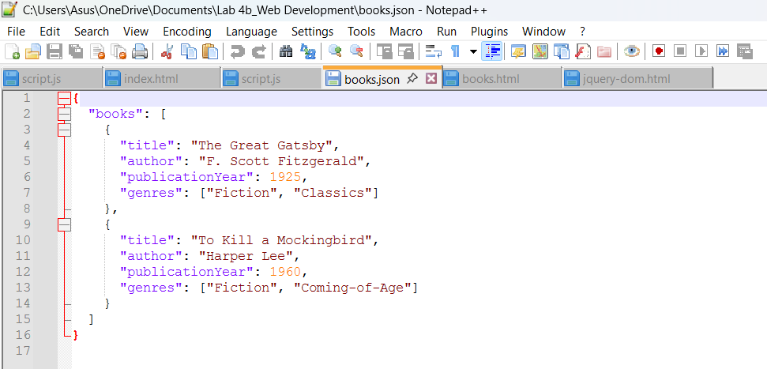
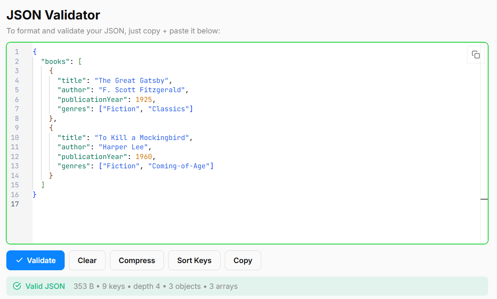
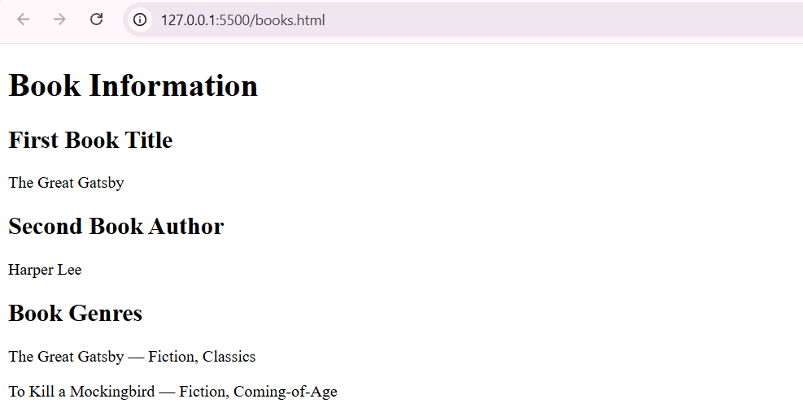
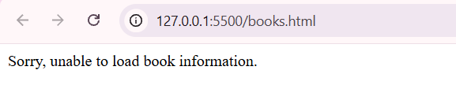
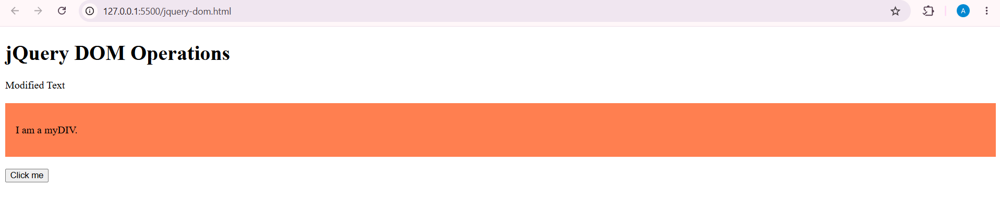
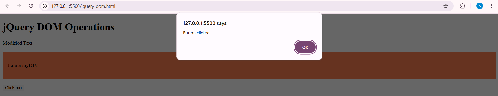

# BIC21203 Lab 4b – Client-Side Scripting (JSON and jQuery)

## Student Information
**Name:** NUR ANISA DIANA BINTI MOHD NOORDIN  
**Student ID:** AI240061  
**Course:** BIC21203 Web Development  
**Lab:** Lab 4b – Client-Side Scripting (JSON and jQuery)

## Brief Explanation

### Question 1: Create and Structure JSON Data
This question demonstrates how to create a valid JSON file containing a collection of books. The `books.json` file contains two book objects with title, author, publicationYear, and genres properties.

### Question 2: Retrieve and Display JSON Data
This question demonstrates how to use the JavaScript `fetch()` API to retrieve data from `books.json`. The retrieved data is displayed on the webpage using `textContent` and `createElement()`. Error handling is implemented to display a message if the JSON file cannot be loaded or parsed.

### Question 3: Compare Native JavaScript and jQuery
This question demonstrates three jQuery DOM operations:
- `.text()` changes the text from "Original Text" to "Modified Text".
- `.addClass()` adds the `myStyle` CSS class to change the background colour.
- `.on("click")` displays an alert message when the button is clicked.

## Files
- `books.json` – JSON dataset containing two books.
- `books.html` – Webpage that retrieves and displays JSON data.
- `jquery-dom.html` – Webpage demonstrating jQuery DOM manipulation and event handling.

## How to Run

### Question 1
1. Open `books.json` in a text editor.
2. Copy the JSON content into a JSON validator.
3. Verify that the JSON is valid.

### Question 2
1. Open the project folder in Visual Studio Code.
2. Install the Live Server extension.
3. Right-click `books.html` and select **Open with Live Server**.
4. The webpage displays the book information.

### Question 3
1. Open `jquery-dom.html` in a browser using Live Server.
2. Verify that "Modified Text" is displayed.
3. Verify that the `myDIV` section has a coral background.
4. Click the button to display "Button clicked!".

**Note:** An internet connection is required to load jQuery from the CDN.

## Screenshots

### Question 1: Create and Structure JSON Data

**JSON Code**

**JSON Validation**

### Question 2: Retrieve and Display JSON Data

**Successful Output**

**Error Handling**

### Question 3: Compare Native JavaScript and jQuery

**jQuery DOM Operations**

**Button Click Alert**

